# 电解液配方 BO 算法构建总结：配方空间 → 候选生成 → 优化推荐

本文总结 `web_for_bo` 中从"配方空间定义"到"候选池生成"再到"贝叶斯优化推荐"的算法设计，依据为当前仓库代码（BoTorch 0.18.1、GPyTorch 1.15.2、SciPy 1.13.1）。实验回传（`observation.csv` 同步、模拟回传）和网页前后端不在本文范围内，只在边界处提及。

## 0. 总览

```mermaid
flowchart LR
    A[设计 JSON<br/>组分 + SMILES + 分数范围] --> B[配置校验<br/>generate_pool.validate]
    B --> C[Scrambled Sobol 撒点<br/>2^power 个点]
    C --> D[有/无掩码 + 连续组成映射]
    D --> E[称量离散<br/>最大余数取整]
    E --> F[离散后复核 + 去重]
    F --> G[pool.csv]
    G --> H[convert_pool<br/>RDKit 规范化 + 稳定 ID]
    H --> I[pool_catalog.csv]
    I --> J[特征归一化]
    J --> K[GP 代理模型]
    K --> L[qLogNEI / qLogNEHVI]
    L --> M[离散贪心批量选点]
    M --> N[recommendation_N.csv<br/>candidate_predictions*.csv]
```



| 阶段 | 封装入口 | 计算实现 | 主要产物 |
| --- | --- | --- | --- |
| 1 配方空间与撒点 | `bayesian_optimization/step_01_formulation/actions.py::generate_formulations` | `pool/generate_pool.py` | `config_snapshot.json`、`components.csv`、`pool.csv` |
| 2 候选池标准化 | `bayesian_optimization/step_02_pool/actions.py::convert_formulations` | `pool/convert_pool.py` | `converted/pool_catalog.csv`、`pool_features.csv`、`pool_manifest.json` |
| 4 模型与推荐 | `bayesian_optimization/step_04_optimization/actions.py::execute_round` | `algorithms/qLogNEI.py`、`algorithms/qLogNEHVI.py`、`algorithms/bo_utils.py` | `training_summary.json`、`model.pt`、`candidate_predictions*.csv`、`recommendation_N.csv` |

核心设计取舍：**先把整个可称量、满足约束的配方空间离散成有限候选池，BO 只在池内选点**。好处是推荐一定可配制、可追溯（每个候选有稳定 `sample_id`），不需要在带等式约束和 0/非 0 结构的混合空间里做连续优化；代价是推荐的分辨率受候选池规模限制（最多 $2^{14}=16384$ 个 Sobol 点）。

---

## 1. 配方空间定义

### 1.1 组分与角色

| 角色 | 数量 | 分数范围的分母 | 说明 |
| --- | --- | --- | --- |
| `primary_salt` | 1–2 | 电解液总质量 | 单盐时始终存在；双盐时两种盐地位相同，下限为 0 的为可选组分，每个候选至少含一种 |
| `balance_solvent` | 恰好 1 | 溶剂池质量 | 基准溶剂，始终存在 |
| `cosolvent` | ≥1 | 溶剂池质量 | 下限为 0 时为可选组分 |
| `functional_additive` / `salt_additive` | 0–8 | 电解液总质量 | 下限为 0 时为可选组分 |

溶剂池指扣除盐和添加剂之后的质量。设盐质量分数为 $s_j$（$j = 1, \dots, n_s$，$n_s \in \{1, 2\}$）、添加剂为 $a_k$、各溶剂在溶剂池中的分数为 $q_i$（$\sum_i q_i = 1$），则最终质量分数为

$$
w = \bigl(s_1, \dots, s_{n_s},\; \phi q_1, \dots, \phi q_m,\; a_1, \dots, a_K\bigr),\qquad \phi = 1 - \sum_j s_j - \sum_k a_k .
$$

组分顺序固定为"盐（按配置顺序）→ 溶剂（按配置顺序）→ 添加剂"，此顺序决定后续特征槽位 `mass_ratio_0 … mass_ratio_{D-1}`。`salt_additive`（如 LiNO3）仍属添加剂，与主盐的区别是不计入锂盐浓度。

### 1.2 输入参数

| 参数 | 网页默认 | 含义 |
| --- | --- | --- |
| `salts[].final_mass_fraction_bounds` | 用户填写 | 每种盐的 $[l_j, h_j]$；`salts` 含 1–2 项，单盐也可沿用 `salt: {...}` 写法 |
| `solvents[].pool_mass_fraction_bounds` | 用户填写 | $[l_i, h_i]$，溶剂池内分数 |
| `additives[].final_mass_fraction_bounds` | 用户填写 | $[l_k, h_k]$ |
| `batch_mass_g` | 5 | 单份配制总质量 $B$ |
| `mass_step_g` | 0.0001 | 称量步长 $\delta$ |
| `minimum_nonzero_mass_g` | 一个称量步长 | 可选组分出现时的最小质量（组分级，可选） |
| `sampling.candidate_power` | 10 | Sobol 点数 $2^{\text{power}}$，取值 3–14 |
| `sampling.seed` | 2026 | Sobol 置乱种子 |
| `sampling.absence_probability` | 0.25（网页未暴露） | 可选组分缺席概率 $p$ |
| `temperature_C` | 25 | 只记录在快照中，**不进入模型特征** |

### 1.3 配置校验（`generate_pool.validate`）

撒点前会拒绝以下情况：

1. 盐不是 1–2 种（或同时给出 `salt` 与 `salts`）、溶剂少于 2 个、基准溶剂不是恰好 1 个、添加剂超过 8 个或角色非法。
2. 组分名不唯一或含字母、数字、下划线以外的字符；SMILES 无法被 RDKit 解析。
3. 任一区间不满足 $0 \le l \le h \le 1$。
4. 溶剂区间不可能凑成 1：$\sum_i l_i > 1$ 或 $\sum_i h_i < 1$。
5. 盐和添加剂上限之和占满全部质量：$\sum_j h_j + \sum_k h_k \ge 1$。
6. $B/\delta$ 不是整数或小于 100（保证至少 100 个称量单位）。
7. `candidate_power` 不在 3–14，或 $p \notin [0, 1)$。
8. 可选盐的上限小于其最小质量分数：$h_j < m_j$（这样的盐永远无法出现）。

通过校验后用 RDKit 规范化 SMILES、计算分子量 $M_c$，并把最小质量换算成总质量分数 $m_c = \max(\text{minimum\_nonzero\_mass\_g}, \delta)/B$。

---

## 2. Sobol 撒点程序设计（`pool/generate_pool.py::generate`）

### 2.1 为什么用 Sobol

Scrambled Sobol 是低差异序列：与独立均匀随机相比，它在单位超立方体 $[0,1)^d$ 中分布更均匀，空洞和聚集更少；在点数为 $2^m$ 时具有平衡性质，因此代码使用 `qmc.Sobol(d, scramble=True, seed).random_base2(power)` 一次生成恰好 $2^{\text{power}}$ 个点。置乱（SciPy 的线性矩阵置乱加数字平移）在保持低差异的同时引入随机性，固定种子即可完全复现候选池和 `sample_id`。

撒点分两层：先在 $[0,1)^d$ 中得到均匀分布的 $u$，再通过确定性映射把每一维 $u$ 转成满足约束的组成。

### 2.2 维度布局

记盐数为 $n_s$、溶剂数为 $m$、添加剂数为 $K$、可选组分数为 $n_{\text{opt}}$（$p=0$ 时为 0）。Sobol 维度 $d = n_s + m - 1 + K + n_{\text{opt}}$：

| Sobol 列 | 用途 |
| --- | --- |
| $u_0, \dots, u_{n_s-1}$ | 盐质量分数 $s_1, \dots, s_{n_s}$ |
| $u_{n_s}, \dots, u_{n_s+m-2}$ | 第 1 至第 $m-1$ 个溶剂的溶剂池分数（最后一个在场溶剂取余量，不消耗新维度） |
| $u_{n_s+m-1}, \dots, u_{n_s+m+K-2}$ | 添加剂 $a_1, \dots, a_K$ |
| 其后 | 每个可选组分一维"是否加入"，顺序为可选盐、可选共溶剂、可选添加剂 |

$n_s = 1$ 时布局与单盐旧版完全相同（$d = m + K + n_{\text{opt}}$），同一配置和种子得到逐字相同的候选池。

例：LiDFOB + NDFA（基准）+ TTE $[0,0.5]$ + FEC $[0,0.35]$ + VC $[0,0.05]$，可选组分为 TTE、FEC、VC，$d = 3 + 1 + 3 = 7$，最多 $2^3 = 8$ 种组分组合。以 `power=10`、`seed=2026` 运行得到 1024 个点，全部可行，覆盖 8 种 `presence_pattern`；把 $p$ 设为 0 时只剩 1 种（全组分）。

### 2.3 可选组分的有/无掩码（`presence_masks`）

双盐设计中下限为 0 的盐、基准溶剂以外下限为 0 的共溶剂，以及下限为 0 的添加剂视为可选组分（单盐设计的盐始终存在）。对每个可选组分 $c$，用其专属 Sobol 列判断：

$$
\pi_c = \mathbb{1}\left[u_c \ge p\right],\qquad P(\text{缺席}) = p .
$$

可选添加剂还要求 $h_k \ge m_k$，否则不可能满足最小质量，直接视为缺席（可选盐的这一条件在校验阶段保证）。

**盐回补**：两种盐都可选且某行同时抽到缺席时，把有/无维度 $u_c$ 较大（最接近被选中）的那种盐补回为在场。规则只看 $u$ 值，不看配置顺序，所以两种盐的地位对称。期望占比为：两种盐都在场 $(1-p)^2$，只含其中一种各 $p(1-p) + p^2/2$；$p = 0.25$ 时分别约为 56% 和 22%。

**溶剂可行性回补**：若某行在场溶剂的上限之和 $\sum_{i:\pi_i=1} h_i < 1$，溶剂池无法凑成 1。此时按配置顺序依次把缺席的可选共溶剂补回为在场，直到上限之和不小于 1。

这一设计让 N 元设计空间中同时包含 N−1 元、N−2 元……子配方，"0%"成为显式的设计状态，而不是连续采样时几乎不可能取到的边界值。

### 2.4 连续组成映射

**盐与添加剂**（都以电解液总质量为分母，取值方式相同）：可选组分的下界提高到最小质量分数，以保证出现时可称量：

$$
s_j = \pi_j\left[f_j + u_{j}\,(h_j - f_j)\right],\qquad
a_k = \pi_k\left[f_k + u_{n_s+m-1+k}\,(h_k - f_k)\right],
$$

$$
f_c = \begin{cases}\max(l_c, m_c) & \text{可选}\\ l_c & \text{非可选（}\pi_c=1\text{）}\end{cases}
$$

**溶剂池：逐项剩余额度法**。先计算溶剂份额 $\phi = 1 - \sum_j s_j - \sum_k a_k$，再把可选共溶剂的下界换算到溶剂池尺度，缺席溶剂的上下界置零：

$$
\tilde l_i = \pi_i \cdot \begin{cases}\max(l_i,\ m_i/\phi) & \text{可选共溶剂}\\ l_i & \text{其他}\end{cases},
\qquad \tilde h_i = \pi_i\, h_i .
$$

令剩余额度 $r_1 = 1$，按配置顺序对每个溶剂 $i$：

$$
L_i = \max\Bigl(\tilde l_i,\ r_i - \sum_{j>i}\tilde h_j\Bigr),\qquad
U_i = \min\Bigl(\tilde h_i,\ r_i - \sum_{j>i}\tilde l_j\Bigr),
$$

$$
q_i = \begin{cases}
0 & \pi_i = 0\\
r_i & i \text{ 为最后一个在场溶剂}\\
L_i + u_i\,\max(0,\ U_i - L_i) & \text{其他}
\end{cases}
,\qquad r_{i+1} = r_i - q_i .
$$

$L_i$ 保证后面的溶剂即使全部取上限也能补足剩余额度，$U_i$ 保证后面的溶剂至少还能取到各自的下限。因此 $\sum_i q_i = 1$，且每个 $q_i$ 都在原区间内。代码不采用"先独立采样再归一化"，因为归一化会把分数推出用户给定的上下限。

其中溶剂 $i$ 用 Sobol 列 $u_{n_s+i-1}$。最终连续组成为 $w = (s,\ \phi q,\ a)$，和为 1。

### 2.5 称量离散（最大余数法）

令称量单位总数 $N = B/\delta$（例如 5 g / 0.0001 g = 50000）。对每行：

$$
n_c = \lfloor N w_c \rfloor,\qquad R = N - \sum_c n_c ,
$$

把剩下的 $R$ 个单位依次加给小数部分 $N w_c - n_c$ 最大的组分；$w_c = 0$ 的组分排在最后，不会被分到单位，因此缺席组分保持精确为 0。离散后称量质量为 $n_c\,\delta$，质量分数为 $\hat w_c = n_c / N$，总质量严格等于 $B$。

### 2.6 离散后复核与去重

取整可能让组成越过边界，所以代码用离散后的 $\hat w$ 重新检查（容差 $10^{-12}$），不通过的行直接剔除：

1. 整数称量向量 $(n_c)$ 已出现过：去重。
2. 每种盐：$l_j \le \hat w_{s_j} \le h_j$（可选盐缺席时 $\hat w = 0 = l_j$，自然通过）。
3. 出现的可选组分满足最小质量：$\hat w_c \ge m_c$。
4. 添加剂：$l_k \le \hat w_{A_k} \le h_k$。
5. 溶剂池：$\hat\phi = \sum_i \hat w_{S_i} > 0$，且 $\hat q_i = \hat w_{S_i}/\hat\phi \in [l_i, h_i]$。

通过的行再计算摩尔分数：

$$
x_c = \frac{\hat w_c / M_c}{\sum_{c'} \hat w_{c'} / M_{c'}} .
$$

可行候选少于 2 个时报错，提示增大采样规模或提高称量精度。

### 2.7 输出

`pool.csv` 与 `feasible_candidates.csv` 内容相同。每行包含 `presence_pattern`（在场组分名用分号连接）、`salt_molality_mol_kg`（全部主盐的总质量摩尔浓度，见下式），以及每个组分的 `<name>_mass_g`、`<name>_mass_fraction`、`<name>_mole_fraction`。函数返回 `generated`（Sobol 点数）、`feasible`（可行候选数）、`components`、`presence_patterns`（不同组分组合数）。

$$
b = \frac{1000\sum_j \hat m_{s_j} / M_{s_j}}{\sum_i \hat m_{S_i}}\ \ \text{mol/kg},
$$

$\hat m$ 为称量质量（g），分母只计基准溶剂与共溶剂。$b$ 只用于展示，不进入特征。`salt_molality_range` 按全部下限和全部上限给出 $b$ 的范围（$b$ 对每个 $s_j$、$a_k$ 单调递增，所以候选一定落在其中）。旧版单盐候选池的这一列名为 `<盐名>_molality_mol_kg`，导入实验时两种列名都兼容。

### 2.8 撒点的性质与注意事项

- **均匀性只在 $u$ 空间严格成立**。逐项剩余额度映射是条件采样，配置顺序靠前的溶剂先取值，所以在约束多面体上的分布不是严格均匀的，且结果依赖溶剂顺序。离散、过滤和去重也会破坏 $2^m$ 点集的平衡性质。
- **有/无维度与连续维度共享同一 Sobol 序列**，因此各组分组合下的子样本仍较均匀地覆盖连续维度；组合 $\pi$ 的期望占比为 $\prod_c p^{1-\pi_c}(1-p)^{\pi_c}$，再受回补规则修正。
- **双盐时总盐量不固定**。两种盐各自独立取值，总盐量在 $\sum_j l_j$ 到 $\sum_j h_j$ 之间浮动；如需控制总浓度，可在离散复核阶段另加过滤。
- **最小质量只对可选组分强制**。单盐、基准溶剂和下限大于 0 的组分只受区间约束；若 $p=0$，下限为 0 的组分会被当作"始终存在"，可能出现只有一个称量步长的极小质量。
- **可复现性**：配置相同且种子相同时，候选内容和后续 `sample_id` 完全一致；$p=0$ 时维度和旧版一致，同一种子得到与旧版相同的候选池。

---

## 3. 候选池标准化（`pool/convert_pool.py`）

转换不修改 `pool.csv`，只生成派生文件：

| 产物 | 内容 | 用途 |
| --- | --- | --- |
| `pool_catalog.csv` | `sample_id`、`chem_group_id`、分类摘要、`source_row`、`presence_pattern`，以及每个槽位的 `compound_i`、`smiles_i`、`mass_ratio_i`、`mole_ratio_i` | BO 实际读取的候选池 |
| `pool_features.csv` | 只含 `{mass|mole}_ratio_i` 数值列 | 纯数值模型接口 |
| `pool_manifest.json` | 输入 SHA-256、版本、设置、组分规范 SMILES 和 InChIKey、计数 | 追溯 |

**稳定 ID**：

- `chem_group_id = "CG_" + SHA256(按配置顺序连接的在场组分 role:InChIKey)[:12]`，表示"活性化学物种集合"，与比例无关。
- `sample_id = "SMP_" + SHA256("ratio_schema=v1|" + 每个组分的 chemical_key:mass=%.10f:mole=%.10f)[:16]`，表示具体配方，与行号无关，重排 CSV 后不变。

**强制校验**：两套比例各自和为 1（容差 $10^{-8}$）；质量和摩尔的"在场"判断一致；比例为 0 时质量必须为 0；`sample_id` 和特征向量不得重复（否则 BO 会把两个候选映射到同一点）。网页流程固定使用质量分数作为特征（`feature_basis="mass"`）。

---

## 4. 基础贝叶斯优化

### 4.1 问题形式化

候选池 $\mathcal{C} = \{x_1, \dots, x_N\}\subset\mathbb{R}^D$ 有限，已测数据为 $\mathcal{D} = \{(x_i, y_i)\}_{i=1}^n$。目标是用尽量少的实验找到

$$
x^\star = \arg\max_{x\in\mathcal{C}} f(x)\quad(\text{单目标})\qquad\text{或}\qquad f(x)\in\mathbb{R}^M\ \text{的 Pareto 前沿}\quad(M = 2\text{–}4).
$$

BO 每轮循环：用 $\mathcal{D}$ 拟合概率代理模型 → 用采集函数权衡"预测好"（利用）和"不确定性大"（探索）→ 从未测候选中选出一批 $q$ 个配方。

### 4.2 数据与特征（`bo_utils.load_experiment_data`）

1. 实验表与候选池按 `sample_id` 对齐；实验表中的配方特征必须与池中一致（容差 $10^{-12}$）。
2. 特征取 `mass_ratio_0 … mass_ratio_{D-1}`（槽位必须从 0 连续编号）。
3. **以整个候选池为范围做 min-max 归一化**，并去掉在全池中恒定的列：

$$
\tilde x_j = \frac{x_j - \min_{\mathcal{C}} x_j}{\max_{\mathcal{C}} x_j - \min_{\mathcal{C}} x_j}\in[0,1].
$$

4. 只有所选目标全部有值的行进入训练集，至少需要 2 行；其余行（未测或部分已测）保留为候选。

### 4.3 高斯过程代理模型（`bo_utils.fit_model_data`）

**目标变换**：最小化目标先取负号统一为最大化，再用 `Standardize` 标准化为 $(y-\bar y)/s_y$；预测时自动反变换回原始单位。

**先验与后验**：$f \sim \mathcal{GP}(\mu_0, k)$，观测 $y = f(x) + \varepsilon$，$\varepsilon\sim\mathcal N(0,\sigma_n^2)$。在新点 $x$ 处：

$$
\mu(x) = \mu_0 + k_x^\top (K + \sigma_n^2 I)^{-1}(y - \mu_0),\qquad
\sigma^2(x) = k(x,x) - k_x^\top (K + \sigma_n^2 I)^{-1} k_x .
$$

**核函数选项**：

| `--kernel` | 实现 | 形式 |
| --- | --- | --- |
| `default` | BoTorch 0.18.1 的 `SingleTaskGP` 默认核：ARD RBF，长度尺度带随维度缩放的 LogNormal 先验，噪声带 LogNormal 先验，不加 ScaleKernel | $k(x,x') = \exp\bigl(-\tfrac12\sum_j (x_j-x'_j)^2/\ell_j^2\bigr)$ |
| `rbf` | `ScaleKernel(RBFKernel)` | $\sigma_f^2 \exp\bigl(-\tfrac12 r^2\bigr)$，$r^2=\sum_j (x_j-x'_j)^2/\ell_j^2$ |
| `matern` | `ScaleKernel(MaternKernel(ν))`，ν ∈ {0.5, 1.5, 2.5} | ν=2.5 时 $\sigma_f^2\bigl(1+\sqrt5 r+\tfrac53 r^2\bigr)e^{-\sqrt5 r}$ |

`--ard` 为每个特征维度配一个长度尺度 $\ell_j$（默认开启，`default` 核强制 ARD），`--lengthscale-init` 只用于 `rbf`/`matern` 的初值。`--noise-std` 给定时使用固定观测噪声 $\sigma_n^2 = \text{noise\_std}^2$（原始目标单位），否则由数据推断同方差噪声。

**超参数拟合**：`fit_gpytorch_mll` 最大化（带先验的）对数边际似然

$$
\log p(y\mid X,\theta) = -\tfrac12 y^\top (K_\theta + \sigma_n^2 I)^{-1} y - \tfrac12\log\lvert K_\theta + \sigma_n^2 I\rvert - \tfrac n2\log 2\pi ,
$$

优化器为 L-BFGS-B，迭代上限为 `fit_maxiter`。

**多目标**：`fit_multi_model_data` 对每个目标独立拟合一个上述 GP（方向和噪声逐目标设置），组合为 `ModelListGP`，即假设各目标相互独立。

### 4.4 采集函数

两种采集函数都通过 Monte Carlo 估计：从联合后验中抽 $N_{\text{mc}}$ 条样本（`SobolQMCNormalSampler`，即用 Sobol 序列生成的准随机正态基样本，方差比普通 MC 更低），再对样本求期望。

**单目标：qLogNEI**（`bo_utils.recommendation`）。噪声期望改进以已测输入 $X_b$ 为 baseline，对候选批 $X$ 和 baseline 的联合后验积分，不需要假定"当前最优值"是精确已知的：

$$
\alpha_{\text{NEI}}(X) = \mathbb{E}\Bigl[\bigl(\max_{x\in X} f(x) - \max_{x'\in X_b} f(x')\bigr)^+\Bigr]
\approx \frac{1}{N_{\text{mc}}}\sum_{t=1}^{N_{\text{mc}}}\bigl(\max_{x\in X}\xi_t(x) - \max_{x'\in X_b}\xi_t(x')\bigr)^+ .
$$

Log 版本（Ament et al., 2023）用平滑近似（`fat=True`，温度 `tau_max`、`tau_relu`）替代 $\max$ 和 $(\cdot)^+$，并在对数空间计算 $\log\alpha$。这样在改进量极小、经典 EI 数值上接近 0 的区域仍能区分候选。BoTorch 默认对 baseline 剪枝（`prune_baseline=True`），只保留在某些后验样本中可能是最优的已测点。

**多目标：qLogNEHVI**（`bo_utils.multi_recommendation`）。超体积 $\mathrm{HV}(\mathcal{P}, r)$ 是 Pareto 集合 $\mathcal{P}$ 相对参考点 $r$ 支配的体积。噪声期望超体积改进为

$$
\alpha_{\text{NEHVI}}(X) = \mathbb{E}\Bigl[\mathrm{HV}\bigl(\mathcal{P}(f(X_b)\cup f(X)),\, r\bigr) - \mathrm{HV}\bigl(\mathcal{P}(f(X_b)),\, r\bigr)\Bigr],
$$

每条后验样本都用盒分解精确计算超体积（`alpha=0`），因此目标数限制在 4 个以内（`MAX_OBJECTIVES = 4`）。Log 版本同样做平滑并取对数。

**参考点**（`bo_utils.initial_reference`）：未指定 `--ref-point` 时，用首轮训练数据自动生成，此后各轮从 `training_summary.json` 复用。记方向符号 $\sigma_j = +1$（max）或 $-1$（min），$\tilde y_{ij} = \sigma_j y_{ij}$：

$$
r_j = \sigma_j\Bigl(\min_i \tilde y_{ij} - 0.1\,\Delta_j\Bigr),\qquad
\Delta_j = \begin{cases}\max_i\tilde y_{ij} - \min_i\tilde y_{ij} & \text{跨度} > 0\\ \max\bigl(\max_i\lvert\tilde y_{ij}\rvert,\,1\bigr) & \text{否则}\end{cases}
$$

即在每个目标最差的已测值之外再退 10% 跨度。传入采集函数前乘以 $\sigma_j$，换到内部"全部最大化"的坐标系。

### 4.5 离散批量选点（`optimize_acqf_discrete`）

候选集为未测候选 $\mathcal{C}\setminus X_b$，批大小 $q = \min(\text{batch\_size}, |\text{未测}|)$，采用**顺序贪心**：

$$
x_k = \arg\max_{x\in\mathcal{C}_{\text{rem}}}\ \alpha\bigl(\{x\}\,\big|\,X_{\text{pending}} = \{x_1,\dots,x_{k-1}\}\bigr),\qquad k = 1,\dots,q ,
$$

每选出一个点就把它设为 pending（后验样本中视为"已安排但未观测"），并从候选集中移除（`unique=True`），然后对剩余全部候选重新打分。打分按 `pool_batch_size` 分块进行，以控制内存。pending 机制让后选的点自动避开与已选点高度相关的区域，起到批内多样化的作用。

选出的归一化特征向量再按最近邻映射回池行号（`_selected_indices`）；距离大于 $10^{-12}$ 时报错，保证推荐行与候选池逐字一致。

### 4.6 预测输出

`predict_candidates` 对所有未测候选分块计算后验，输出原始单位下的均值和**潜在函数**后验标准差 $\sigma(x)$（不含观测噪声），写入 `candidate_predictions.csv`（后续轮次为 `candidate_predictions_N.csv`）。推荐行从 `pool_catalog.csv` 原样复制，目标列留空，写入 `recommendation_N.csv`。

### 4.7 单轮流程

```text
输入：experiment.csv / observation.csv，pool_catalog.csv，超参数
1. 按 sample_id 对齐，读取 mass_ratio_* 特征，按全池范围归一化，去掉恒定列
2. 取目标完整的行作为 (X_b, Y)，要求 n ≥ 2；其余行为候选
3. 拟合 GP：单目标 SingleTaskGP；多目标 ModelListGP（每目标一个 GP）
4. 记录 training_summary.json 与 model.pt
5. 分块预测全部未测候选的 μ、σ → candidate_predictions*.csv
6. 构造采集函数：
     单目标 qLogNEI(X_baseline = X_b)
     多目标 qLogNEHVI(X_baseline = X_b, ref_point = r)
7. 在未测候选中顺序贪心选 q 个点，映射回 sample_id
8. 写出 recommendation_N.csv
```

### 4.8 超参数一览

| 参数 | 网页默认 | 命令行默认 | 作用 |
| --- | --- | --- | --- |
| `batch_size` | 3（1–20） | 3 | 每轮推荐数 $q$ |
| `mc_samples` | 128（16–2048） | 256 | QMC 后验样本数 $N_{\text{mc}}$ |
| `fit_maxiter` | 100 | 200 | 边际似然优化迭代上限 |
| `seed` | 2026 | 2026 | 采样器与 PyTorch 随机种子 |
| `pool_batch_size` | 128 | 128 | 候选打分分块大小 |
| `feature_basis` | `mass` | `mass` | 质量或摩尔分数特征 |
| `kernel` / `matern_nu` | `default` / 2.5 | 同左 | 核函数 |
| `ard` / `lengthscale_init` | 开 / 0.5 | 同左 | ARD 与长度尺度初值 |
| `noise_std` | 留空（自动推断） | 无 | 固定观测噪声（每目标一个） |
| `ref_point` | 留空（自动） | 无 | 多目标参考点（原始单位） |

---

## 5. 可扩展：基于距离的撒点（当前未接入）

`web_for_bo` 目前没有"初始实验点选择"步骤：Sobol 生成的是完整候选池，BO 冷启动依赖用户上传至少 2 条完整实验。若要在第 0 轮从池中挑出 $k$ 个分散的初始配方，可以接入基于距离的空间填充选点。上游 DoE 仓库（`No_anode/AFLMB-AL/utils.py::farthest_point_space_filling`）已有参考实现。

**准则（maximin）**：在特征嵌入 $z(x)$ 下选出子集 $S\subset\mathcal{C}$，$|S| = k$，使得包括固定点 $F$ 在内的最小两两距离最大：

$$
S^\star = \arg\max_{|S|=k}\ \min_{z_a \ne z_b\,\in\, z(S)\cup z(F)} \lVert z_a - z_b\rVert_2 .
$$

**贪心最远点近似**：维护每个候选到"已选集合加固定集合"的最近距离 $d(z)$，复杂度 $O(kN)$。

```text
若 F 非空：d(z) = min_{f∈F} ||z − f||；否则 d(z) = ||z − 质心||
重复 k 次：
    z* = argmax_z d(z)；加入 S；d(z*) = −∞
    d(z) = min(d(z), ||z − z*||)
```

**接入要点**：

- 嵌入 $z$ 建议直接使用 BO 的归一化特征 $\tilde x$，让"初始点分散"与 GP 看到的距离一致；参考实现中使用的盐载量加 $\sqrt{\text{组成}}/\sqrt2$（Hellinger 型）嵌入，也适用于单纯形上的组成数据。
- 已测配方可作为固定集 $F$，这样补充实验会自动避开已有数据。
- 参考实现还支持全空间最小距离和 PCA 二维投影最小距离双约束，并在贪心之后做若干轮交换优化（`exchange_passes`），以提升真实高维 maximin 距离。

---

## 6. 当前实现的限制与可改进方向

1. **特征线性相关**：各组分质量分数之和为 1，$D$ 维特征实际只有 $D-1$ 个自由度，ARD 中会有冗余维度。由于存在精确的 0，不能直接改用对数比变换。
2. **溶剂顺序依赖**：逐项剩余额度法的结果依赖溶剂顺序，在约束多面体上不是严格均匀分布。
3. **归一化依赖候选池范围**：导入池外配方会把配方追加到 `pool.csv` 并重新转换，候选池范围可能随之变化，导致各轮特征尺度和 `lengthscale_init` 的含义不完全一致。
4. **分辨率受池规模限制**：BO 只在池内选点，最优解精度受 $2^{\text{power}}$ 和过滤后的可行数限制；池耗尽时停止推荐。
5. **温度不是特征**：每个设计固定一个温度，跨温度数据不能在同一模型中学习。
6. **参考点固定**：多目标参考点由首轮数据确定并沿用，后续数据分布明显变化时可能需要手动指定 `--ref-point`。
7. **最小质量约束只作用于可选组分**（见 2.8）。

---

## 7. 代码位置索引

| 功能 | 位置 |
| --- | --- |
| 配置校验与组分规范化 | `pool/generate_pool.py::salt_list`、`validate` |
| 可选组分、有/无掩码与回补 | `pool/generate_pool.py::optional_salts`、`optional_components`、`presence_masks` |
| 锂盐浓度范围 | `pool/generate_pool.py::salt_molality_range` |
| Sobol 撒点、组成映射、离散、复核 | `pool/generate_pool.py::generate` |
| 稳定 ID 与特征表 | `pool/convert_pool.py::transform_rows`、`convert` |
| 数据对齐与归一化 | `algorithms/bo_utils.py::load_experiment_data` |
| GP 拟合（单目标 / 多目标） | `algorithms/bo_utils.py::fit_model_data`、`fit_multi_model_data` |
| qLogNEI 选点 | `algorithms/bo_utils.py::recommendation` |
| 参考点与 qLogNEHVI 选点 | `algorithms/bo_utils.py::initial_reference`、`multi_recommendation` |
| 候选预测与推荐写出 | `algorithms/bo_utils.py::predict_candidates`、`save_candidate_predictions`、`save_recommendations` |
| 单轮入口 | `algorithms/qLogNEI.py::run`、`algorithms/qLogNEHVI.py::run` |
| 网页调用参数组装 | `bayesian_optimization/step_04_optimization/actions.py::command_for` |
| 距离撒点参考实现（仓库外） | `No_anode/AFLMB-AL/utils.py::farthest_point_space_filling` |
