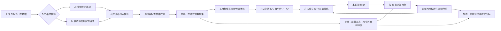

# 离线贝叶斯优化回放与采集策略比较：页面及实现方案

日期：2026-10-22

状态：完整设计与后续规划；第一版已实现，具体支持范围、运行入口与限制以 [V1 使用说明](OFFLINE_BO_V1_GUIDE.md)为准。本文中未列入 V1 的增强项仍为规划。

## 1. 建议采用的方案

新增独立入口「离线策略比较」。用户选择现有数据或上传 CSV，先按「实验配方格式」或「候选池模拟配方格式」完成配方信息校验，再选择目标性质、校验目标列，通过后生成**封闭候选池**并开始优化。每次回放只公开少量初始实验，随后执行：推荐配方 → 从上传数据查找对应目标值 → 通过现有回传逻辑加入观测 → 再推荐。

这能够回答：**在这批已测配方、给定初始样本与预算下，哪种采集策略更快、更稳定地找到数据集中的最好配方？**

首版建议：

- 只做单目标，支持最大化、最小化；直接读取用户选择的目标列。
- 固定同一候选池、初始样本、GP 设置和实验预算，比较采集策略。
- 默认比较现有五种偏向寻优的采集函数，加一个无模型随机采样基线；纯探索策略作为可选项。
- 每组随机初始化同时交给所有方法，默认 20 组配对重复；快速试运行用 5 组。
- 以「最优发现轮次」为直观结果，同时显示命中率、累计配方数、固定预算下的性能差距和全过程收敛曲线。
- 新增离线调度及结果汇总层，复用配方转换、GP、采集函数和回传校验逻辑，保留现有在线实验流程。

**不把完整真值 CSV 当作模型的初始实验表，不调用现有随机模拟实验按钮来产生离线真值。**

本次首选示例已确定为用户提供的 `pool_catalog_crr_preprocessed.csv`，目标列为 **`CRR[%]`**，默认按**最大化**回放。文件核对与适配要求见第 4.3 节；先以其中 41 条历史配方作为待校验输入，最终纳入数量由配方与目标两阶段校验确定，不默认沿用此前假设的 48 条数据。

## 2. 先明确比较的对象

### 2.1 这里比较的是采集策略

当前 [algorithms/acquisitions.py](../algorithms/acquisitions.py) 注册了 6 种单目标策略，数量应由 `/api/v1/acquisitions` 动态提供：

| ID | 页面名称 | 首版建议 | 备注 |
|---|---|---|---|
| `qlognei` | qLogNEI | 默认选中 | 含噪声观测下的期望改进 |
| `qlogei` | qLogEI | 默认选中 | 以已观测最好值为改进基准 |
| `qucb` | qUCB | 默认选中 | 固定 β=2；其他 β 应作为独立方法实例 |
| `qpi` | qPI | 默认选中 | 改进概率 |
| `qsr` | qSR | 默认选中 | q=1 时等价于最大化后验均值；批量 q>1 时为期望批次最好值，不能简单称为逐点取均值最高 |
| `qstd` | qPosteriorStd | 可选 | 纯探索，偏向建模；找最优值只是它的一种评价视角 |
| `random` | 随机采样 | 默认选中 | 新增离线基线，从剩余候选中均匀无放回抽取，不训练 GP |

首版默认共 6 个方法实例：5 个已有 BO 策略 + Random。方法实例需包含参数，例如 `qucb_beta_2`；不要把多个不同 β 的结果混为一条 qUCB 曲线。

### 2.2 与 Sobol 候选池撒点分开

前一步的 Sobol 是**构建候选池**；本页比较的是**同一个候选池中下一批选谁**。首版回放池直接来自有真值的实验 CSV，不再额外混入 Sobol 生成但没有真值的点。

这次比较不能据此断言「某种连续空间撒点方法普遍最好」，也不能证明找到全部化学空间中的全局最优。若以后要比较 Sobol、LHS 等候选池构建方法，需要另设实验，保证每个被查询的点都有可用评价；不能给缺少实测值的点用 GP 预测值冒充实测。

若后续要评估 `qstd` 的建模能力，可增加独立且固定的留出集误差指标，留出集不参与推荐或训练。不能用训练集拟合误差代替泛化能力，也不宜用每轮不断缩小的未测集合直接比较误差曲线。

## 3. 对当前代码的核对及复用范围

| 当前模块 | 已有能力 | 离线接入要求 |
|---|---|---|
| [pool/import_experiments.py](../pool/import_experiments.py) | 解析实验 CSV、组分称量转换、配方对齐、重复配方按目标取均值、生成 ID | 复用解析和转换；在离线独立目录中生成数据，不改写在线设计 |
| [pool/convert_pool.py](../pool/convert_pool.py) | 质量／摩尔分数特征、`sample_id`、`chem_group_id` | 沿用统一身份规则，固定组分列；未加入的盐保留 0 |
| [algorithms/bo_utils.py](../algorithms/bo_utils.py) | 按 ID 对齐、归一化、GP 拟合、离散池推荐、累计观测合并 | 推荐端只接收初始与已经揭示的实测；输入特征不包含任何目标列 |
| [algorithms/qLogNEI.py](../algorithms/qLogNEI.py) | 通过 `--acquisition` 切换单目标策略，多轮推荐 | 继续复用，不复制一套采集函数实现 |
| [bayesian_optimization/step_04_optimization/actions.py](../bayesian_optimization/step_04_optimization/actions.py) | 命令参数构造、执行算法子进程、生成可视化 | 离线调度可复用命令构造；每轮完整可视化应改为可选，避免批量回放反复绘图 |
| `POST /api/v1/optimization-runs/<run_id>/feedback` | 支持 `measurements` 或 CSV；核对本轮推荐、完整目标和配方一致性，合并观测 | 复用请求契约与共同处理逻辑；真值来自离线查表 |
| `POST /api/v1/optimization-runs/<run_id>/next-round` | 检查回传完成后执行下一轮 | 复用状态约束；离线由后端自动推进 |
| [algorithms/simu_experiment.py](../algorithms/simu_experiment.py) | 未知配方目标值通常在已有观测范围内随机生成 | **不用于本功能**；离线必须按配方 ID 查真实值 |

两个需要明确的现状：

1. 当前 `qLogNEI.py` 先执行 `sync_observations`，再从观测表训练。如果把全量实验 CSV 直接作为 `--experiment`，全部真值会在第 0 轮被读入；必须创建只含初始样本的运行用实验表。
2. 当前回传接口把来源记为 `real`，模拟接口记为 `simulated`。离线实测回放应有独立的 `offline_lookup` 来源，避免页面把历史值回放显示为本轮新增真实实验；旧的在线回传语义不变。

## 4. 数据输入与校验

### 4.1 先检验配方，再检验目标性质

用户可以「使用已上传数据」或「选择 CSV 文件」，两个入口都进入同一校验流程。**数据来源入口与配方格式校验类型是两个不同设置**，不能把“已有／新上传”当成用户要求的两种校验。

流程固定为：

```text
读取表格
  → 识别／选择数据格式
      ├─ A. 实验配方格式校验
      └─ B. 候选池模拟配方格式校验
  → 绑定对应设计配置，检验配方约束
  → 汇总为统一配方表 X，通过配方校验
  → 选择目标性质列、方向与单位
  → 检验目标值及配方—目标一一对应关系
  → 冻结最终候选与目标查找表
  → 配置策略、初始样本和预算，开始优化
```

两种格式是**替代路径**：符合其中一种格式并通过对应约束即可进入下一步，不要求同一个文件同时具备两套结构。不能在配方未通过时直接选目标启动，也不能仅因为找到一个数值性质列就认为整个文件可用。

配方格式与目标来源同样分开记录：候选池式表格可能带实测性质，也可能带外部计算／模拟性质；格式本身不能证明目标是实测。离线比较使用已有的有限目标值，不因选择“模拟配方格式”而调用随机模拟器补目标。

复用现有上传组件、组分解析和身份规则，原文件及原在线设计只读。没有现成候选池时，离线适配器从有效配方生成最小 catalog，不要求先做 Sobol 撒点。首版不扩展到任意无化学身份的数值特征表。

实验配方格式示例（目标列可以存在，但要在配方校验之后才选定）：

```csv
experiment_id,LiPF6_mass_g,LiFSI_mass_g,DME_mass_g,TTE_mass_g,EC_mass_g,Conductivity
E001,0.5,0,2.0,1.0,1.5,7.2
E002,0.3,0.2,1.5,1.5,1.5,8.1
```

### 4.2 两种配方校验与共同的目标校验

#### 4.2.1 公共表格检查及格式识别

先检查 CSV 可读、表头不重名、行列完整。格式识别只依据字段结构，不读取目标高低做路由：

- 存在明确组分的 `*_mass_g` 或 `*_mass_fraction` 列，识别为 A 的候选格式。
- 存在成组 `compound_i`、`smiles_i` 和 `mass_ratio_i`／`mole_ratio_i`，识别为 B 的候选格式。
- 两套都存在时，报告为混合格式，显示两条路径各自的检查结果；不沿用当前导入器优先使用 `compound_i` 的隐式规则。用户可选择可靠路径，或采用事先声明、已交叉校验的适配方案。
- 只有 ID 和目标，没有配方信息的表，必须能按唯一 ID 精确关联到已绑定的标准候选池；不能关联就阻止继续。
- 无法识别的格式报缺失字段及支持的模板，不猜测 `ratio_i` 的质量／摩尔含义。

#### 4.2.2 A：满足当前实验配方的数据

以当前实验模块支持的明确组分称量表或质量分数表为输入，检查内容包括：

| 检查项 | 通过条件 |
|---|---|
| 组分身份 | 与绑定设计的组分库一致；未知物质、重名冲突或无法确定身份的列报错 |
| 用量／比例 | 数值有限、非负；质量总量大于 0；分数基准与单位明确；质量列和分数列不未经声明混用 |
| 归一化与一致性 | 从质量计算统一分数；已有分数与质量互相吻合；纯分数输入符合声明的求和与容差规则 |
| 盐与溶剂约束 | 满足绑定设计的盐种数、必含溶剂、选中时用量上下限及启用的浓度／比例约束 |
| 实验条件 | 温度、测试协议等相容；不能在未编码条件时合并不同条件的同名配方 |
| 实验身份 | `experiment_id` 可追溯；统一后的配方生成内部 `sample_id`，重复配方建立分组 |

0 表示未加入组分，不能当作缺失值填补。称量步长、最小非零量等依数据来源及配置检查：原始实验称量、由比例生成的参考质量需分别标记，不能把后者误当成实际称量记录。

#### 4.2.3 B：满足候选池类型的模拟配方数据

以候选池式配方目录为输入，检查内容包括：

| 检查项 | 通过条件 |
|---|---|
| 槽位结构 | 索引完整；组分名、化学身份与比例逐槽对应；非零比例不能对应空名称或缺失身份 |
| 化学信息 | `smiles_i`／绑定 manifest 中的身份有效且与名称对应；完整盐和拆分离子不能未经转换混为同一特征体系 |
| 比例基准 | 明确采用质量或摩尔分数；非负、有限、和为 1（按声明容差）；若两套都有，按分子量检查一致性 |
| 全池特征对齐 | 可通过明确组分身份重排为统一列；不能将某一行的盐 A 与另一行的盐 B 仅因槽位同号就当作同一特征 |
| 候选身份 | `sample_id` 唯一且与规范化配方一致；来源若只有 `pool_formulation_id`，建立来源映射后生成／校验内部 ID |
| 设计约束 | 满足绑定候选池的盐组合空间、溶剂必含、比例／浓度范围等；需要的 manifest／配置缺失时补充绑定，不能直接宣称通过 |
| 重复与来源 | 重复向量合并或明确拒绝，保留来源 ID；记录配方为生成／模拟来源，不据格式推断目标性质来源 |

若只有一种分数基准，可在化学身份明确后计算另一种并记录转换；不能为了凑齐列而用 0 填未知比例。由生成算法产生的点也必须实际检验约束，不能只信任 `constraint_*_pass` 标签。

#### 4.2.4 两条路径汇合为标准配方表

两条路径通过后，都输出统一的 `sample_id + 固定组分顺序 + X + 来源映射`，并给出逐行的 `schema_valid`（格式是否有效）与 `design_valid`（是否满足绑定约束）。这两类结果不得合并为一个无法解释的“上传失败”。

数据集状态建议为 `uploaded → formulation_validated → target_validated → frozen`；失败保留在对应阶段并附报告。目标或目标缺值处理改变时重做目标校验和冻结；配方、格式路径或绑定设计改变时，从配方校验重新开始并使已有目标校验失效。后端同样检查状态，不能仅靠前端按钮禁用保证顺序。

若仅格式通过、配方超范围，须列出失败约束。当前设计校验模式下不能直接标为可优化；可显式排除这些行并冻结剩余集合，或绑定与历史／模拟来源匹配的另一份设计配置后重新校验。不得为通过检查修改配方、自动扩宽范围或沿用旧的“导入后仅警告”作为离线启动放行条件。

同时显示原始行数、有效配方数、重复配方组、单盐／双盐数量、组分和恒定特征。此时尚不因某行目标较好而选择保留它，也不依据目标进行配方修复。

#### 4.2.5 配方校验后选择并校验目标性质

配方校验通过后，页面才开放目标性质设置。用户选择列名、最大化／最小化、单位与目标来源（实测或外部模拟／计算），然后检查：

1. 目标列存在，原始名称与安全内部别名可逆映射且不与特征、ID、内部字段冲突；`CRR[%]` 按第 4.3 节映射，不要求用户改原表头。
2. 目标是有限数值；目标 0 是有效数值，空白与 0 区分；NaN、Inf 和非数值给出逐行信息。物理上下限只有在用户或性质定义已明确时才检查，不从“%”自动猜出完整可行范围。
3. 每个纳入回放的唯一配方都有目标值，并按内部 ID 一一对应。缺值不补造；可显式排除并报告，然后重新检查池规模与预算。
4. 重复配方按所选目标聚合为一个候选，保留重复次数和原始值；初始点与剩余点之间不能有同配方重复泄漏。
5. `LCE`、`logCE` 等不同性质不自动互换；变换需显式记录。全池目标相同则标为无区分度，不进行优劣排名。
6. 最终池 N 与比较协议满足 `2 ≤ n_init < total_budget ≤ N`，通过后冻结数据、配置及目标映射，再开放开始优化。

离线回放每次返回该配方已有的聚合目标值，不额外加噪声、不因选择模拟配方格式就随机生成目标。实测与外部模拟目标分别标记、分别汇报，默认不混成一份真值表。只有配方信息而没有性质值的候选池，可以用于在线推荐，但不能直接做本页要求的完整离线查表比较。

若 CSV 缺少温度／协议等条件字段，程序只能校验共同条件声明并留存，不能自动推断每行是否真的同条件。配方通过、目标通过及最终可优化状态应分别可见。

### 4.3 指定 CRR 示例：实际检查及适配约定

来源：[pool_catalog_crr_preprocessed.csv](/Users/zilinchen/Downloads/pool_catalog_crr_preprocessed.csv)。原始文件只读，所有适配结果另存到离线数据目录。

| 项目 | 本次核对结果 |
|---|---|
| 原始行／列 | 41 行、85 列 |
| 唯一配方 | 按 8 种组分的归一化质量分数检查为 41 个唯一配方 |
| 现有身份列 | `pool_formulation_id`，41 个唯一值；没有 `sample_id` 列 |
| 目标 | `CRR[%]`，41 个有限数值，无空白或无效值；原单位为 % |
| 回放方向 | 默认最大化；保持原始百分数数值，不自动除以 100 |
| 目标范围 | 14.93–85.44 |
| 温度 | `temperature[C]` 全部为 25.0；其他测试协议仍需由数据集声明确认 |
| 盐组成 | 21 个单盐配方、20 个双盐配方 |
| 溶剂组成 | 按明确组分质量列核对，41 个配方均含 TTE、FEC、DME |
| 当前设计约束标记 | `constraint_current_design_pass=True` 为 35 条，False 为 6 条 |
| 文件指纹 | SHA-256：`e7868db9b0a2ca5ea7d89d0641426f7c7304cdb8ff4f95b673d535ca50dafe50` |

**A. 目标列保留原名，模型内部使用安全别名。**

当前 `web/server.py` 的 `TARGET` 正则以及前端 `checkTargets()` 仅允许英文字母开头、字母／数字／下划线组成的目标名，`CRR[%]` 会被拒绝。现有优化算法按字符串索引目标列，本身不要求这种正则。

目标列需要可逆的内部别名。第一版实际记录 `column="CRR[%]"`、`engine_column="offline_target"`（通用单目标别名），不要求用户改原表头：

- 上传选择、数据集预览、图表与报告均显示 `CRR[%]`，原始 CSV 不改名。
- 为复用当前校验和回传契约，运行用 `experiment.csv`、`observation.csv`、推荐 CSV 及 measurements 使用 `offline_target`。
- 查表时从冻结的 `truth.csv` 原列读取值，再映射到内部别名；映射随数据集与比较配置冻结。
- 别名必须检查重名和内部字段冲突。禁止默默删除 `%[]`，也不因用户选择此示例就全面放宽在线目标名规则。
- 用户报告按原名展示，运行配置提供原名与内部名映射。该适配在离线第一版生效，在线目标名称规则保持原样。

**B. 组分槽位必须先重建，不能直接把这个文件当作现有标准 catalog 上传。**

该 CSV 同时包含旧的分子／离子槽位、固定配方质量分数和明确的组分质量列。41 行均存在 `compound_i` 与同槽 `mass_ratio_i` 不一致，且均存在名称空白但比例大于 0 的槽位。例如首行 `compound_0=TTE`，但 `mass_ratio_0=0.0756`，而 `TTE_mass_g / 总质量 = 0.4046`。

本次核对发现，`mass_ratio_0...7` 与以下固定顺序的明确质量列相符：

```text
LiDFOB, LiPF6, LiFSI, LiBF4, LiTFSI, TTE, FEC, DME
```

适配时仍以这 8 个明确的 `<组分>_mass_g` 列为主，除以各行总参考质量重建统一分数；再以该顺序重建 `compound_i`、完整盐的化学身份／SMILES、角色和摩尔分数。旧 `compound_i` 中的阴离子名称、单独 `Li+` 及空名称不沿用到新的完整盐特征中。

现有 `catalog_to_fractions` 遇到 `compound_0` 与 `mass_ratio_0` 会优先按 catalog 解析，所以适配器应**显式构造只含所需字段的中间表**，不能仅添加 `sample_id` 后把混合表原样交给导入器。

额外核对结论：

- 所有行参考质量合计均在约 `5 ± 1e-9 g`；文件的 `mass_basis` 明示这些是由归一化配比生成的参考质量，**不应称为原始实测称量质量**。
- 14 行的 `source_mass_ratio_json` 原始比例和不严格等于 1，但归一化后与明确质量列一致，最大比较误差小于 `1e-9`；按已记录的归一化规则交叉核验，不误报为 14 条错误配方。
- 现有 `ratio_i`、旧槽位的 `mole_ratio_i` 不自动作为本次模型输入；摩尔分数模式从重建后的完整组分重新计算。
- `raman_file*` 等路径只作为来源元数据保留；本次组分 BO 不读取这些外部文件、不把文件名或路径编码为模型特征。
- 将 `pool_formulation_id` 保留为 `source_pool_formulation_id`，保留 `electrolyte_code`、`formula_name` 等来源映射；按重建后的标准配方生成内部 `sample_id`，不假设原 ID 与新身份规则必然相同。

**C. 该混合表示示例优先按 A 路径检验，约束通过后确定最终池。**

本文件有明确的 8 种组分参考质量列，适合先按 A 路径检验和重建；旧槽位未经修复不能通过 B 路径。其配方来源、参考质量来源仍如实记录，不因选择 A 格式而改称实际称量记录。

41 条是待校验的完整历史输入集合，不表示它们已全部满足当前设计。文件中 6 条 False 不是目标无效，但必须按当前绑定设计重新计算约束，不能拿已有布尔标记代替本次校验。

若采用 `current_design_only`，仅将重新校验通过的配方纳入最终池；若希望使用 `all_historical` 全量历史池，必须绑定匹配的历史设计配置并重新通过，而不是绕过约束。以下 35／41 条及最好值仅描述文件既有标记分组，最终结果以实际校验为准。两个池必须重新各自计算最优值，不能共用基准或合并排行榜：

| 回放池 | N | 池内最好 CRR[%] | 说明 |
|---|---:|---:|---|
| 全量历史输入（待匹配配置校验） | 41 | 85.44 | 来源配方 `DTF-045`，`electrolyte_code=LG091696`；这行当前约束标记为 False |
| 文件当前约束标记为 True 的子集 | 35 | 82.63 | 需要按绑定设计重新验证，不能直接认定这 35 条全部通过 |

这些已知最优值只供评价器及结果展示，不送入 GP、采集函数、初始化或超参数选择。全量历史池应使用离线专属配置保留真实配方，不能为了通过在线范围检查修改组成或目标。

## 5. 真值隔离与自动回放

### 5.1 数据分层

| 文件／数据 | 可读取的内容 | 允许的使用者 |
|---|---|---|
| 原始上传、`truth.csv` | 全部配方及全部实测目标 | 数据校验、查表回传、指标计算 |
| `pool_catalog.csv` | 固定候选池的组分、身份与特征；**不含目标、目标排名、全池最优标记** | 所有推荐方法 |
| 每次重复的 `initial_ids.json` | 当前种子的初始配方 ID | 所有方法共享同一份 |
| 方法专属 `experiment.csv` | 初始配方及其目标值 | 本方法推荐端 |
| 方法专属 `observation.csv` | 初始 + 本方法已经查询并回传的配方及目标 | 本方法推荐端 |
| `trace.csv`、汇总指标 | 推荐轨迹、揭示值、最优命中与性能差距 | 评价与结果页面 |

允许使用全候选池的 **X** 做固定输入归一化，这与现有离散池实现一致；所有方法采用同一变换。Y 标准化、噪声估计和 GP 超参数拟合只能使用已经公开的观测。查表真值路径不传入算法命令参数，也不把全池最好值传给 EI、UCB 或其他采集函数。

这是代码与数据流层面的隔离，不宣称对本机进程做了操作系统级访问控制；验收重点是推荐代码的实际读取路径与训练样本内容。



### 5.2 一次方法回放

```text
固定候选池 X、初始 ID 集 I0、初始观测 y[I0]
保存 round=0 的指标，记录是否初始化已经命中最好配方

while 已揭示配方数 < total_budget:
    q_effective = min(配置的批大小, 剩余预算, 剩余候选数)
    仅用已公开观测拟合 GP，再从未测候选推荐 q_effective 个 ID
    # Random 分支不训练 GP，直接从相同剩余候选中无放回随机选点
    在后端 truth_by_id 中查询这批 ID 的真实目标值
    构造 measurements，复用回传校验、写入与观测同步
    保存本轮完整轨迹与检查点，再推进下一轮

汇总首次命中、最终差距及曲线
```

第一次自动推荐为 round=1，初始样本统一是 round=0。`q_effective` 在尾批不足时自动缩小，不能超过剩余预算；每轮记录实际批大小，不能按固定 q 盲算成本。

主比较建议跑到共同预算结束，即使某方法已经命中最优，也继续保留同样的预算协议，首次命中轮次保持不变。另一个“达到目标即停止”的固定目标模式可以以后增加，不能和固定预算结果混在同一排行榜。

## 6. 公平比较协议

### 6.1 本次 41 个唯一配方示例的首版默认值

| 参数 | 建议值 | 说明 |
|---|---|---|
| 初始配方数 `n_init` | 8 | 模型至少需 2 个，8 是本项目的可调整起点，不是统计最优结论 |
| 每轮推荐数 `batch_size` | 1 | 最容易解释“第几轮找到”；以后支持与实际实验批次一致的 q |
| 总配方预算 `total_budget` | 24，**含初始 8 个** | 留下 16 次主动查询；不要默认 41 全测完来比较最终性能 |
| 快速试运行 | 5 次配对重复 | 只看流程与耗时，不据此宣称方法优胜 |
| 正式比较 | 20 次配对重复，可提高到 30 | 展示分布与配对差异；重复数不是显著性保证 |
| 初始化方式 | 均匀无放回 | 不读取任何目标值 |
| 共同 GP | 沿用现有默认核、特征基准、噪声与拟合设置 | 所有 BO 方法一致；Random 无 GP |
| qUCB β | 2 | 若比较多个 β，分别列方法实例，启动前固定 |

数据集不是 41 个配方或启用 35 条约束子集时，页面按实际 N 给出建议，最终要求合法预算；不能把上表数值硬编码用于所有数据集。

### 6.2 配对初始化和随机性

- 对每个 `repeat_id`，先生成并保存一份 `initial_ids`；本次重复中的所有方法使用完全相同的初始配方及已知目标值。
- 不同重复使用不同初始集合。先按稳定 ID 排序，再用独立随机数流抽取，避免 CSV 行顺序改变实验。
- 初始化只使用组分和 ID，绝不按目标排序后“均匀取样”，也不为避免第 0 轮命中而删除最好样本。
- 设独立的 `initialization_seed`、`model_seed`、`acquisition_seed` 和 `random_baseline_seed`；从主种子与重复编号确定性派生并记录。所有 BO 方法在同一重复使用相同拟合种子协议和 MC 样本预算；策略轨迹分化后不要求其随机数调用序列相同。
- 如果增加“单盐／双盐分层初始化”，按已知组分标签分层，不使用 y。本示例 21 单盐、20 双盐时可取各 4 个作为另一种初始化协议；所有方法共享它，并与均匀初始化分开汇报。8 个初始点不能保证覆盖全部 15 个盐组合。
- 不因为某方法第一次表现差而单独调参或换种子。用本数据调过的参数结果应标为探索性比较；要验证泛化，应在其他独立数据集或预先留出的任务上确认。

### 6.3 实验预算与计算成本分开

主要横轴使用累计揭示的唯一配方数；轮次为辅助横轴。不同 q 的方法不能只比较轮次。

另报 CPU／墙钟耗时、拟合失败次数与总任务耗时。回传查表耗时不等于真实实验耗时；除非 CSV 另有可信实验成本字段，否则不得展示推算的“节省实验小时数”。

## 7. 评价指标及精确定义

### 7.1 统一优化方向

定义 `z_i = y_i`（最大化）或 `z_i = -y_i`（最小化）。令：

- `z_star = max(z_i)`，只在冻结后的最终回放池内计算。
- `O_t` 为第 t 轮回传完成后的已公开配方，`O_0` 是初始集合。
- `b_t = max(z_i for i in O_t)`。
- `g_t = z_star - b_t`，为基于已测最好配方的 simple regret，越小越好。

所有命中均以**已经回传的既有目标值**判定；本次 CRR 示例对应实测值，外部模拟数据则对应其事先提供的模拟／计算值。模型预测最高、候选排名最高不算已经发现最好配方。

### 7.2 命中目标与并列最优

1. **数据集最好值命中**：任意并列最优配方都算成功。数值比较仅使用固定的小容差，容差配置写入 manifest；示例 `atol=1e-12, rtol=0`，这只是计算容差，不是实验误差。
2. **实用阈值命中**：可选 `y ≥ τ`（最大化）或 `y ≤ τ`（最小化）；阈值在实验前固定。
3. **近最优命中**：可选 `g_t ≤ δ`，δ 按目标原始单位设置并事先冻结。不要默认用“最好值的 95%”，因为负数、log 指标及接近 0 的目标会使其含义失真。

精确最优命中与近最优命中是两类指标，分别展示，不静默把后者称为找到最好配方。

### 7.3 必须同时展示的结果

| 指标 | 定义及页面解释 |
|---|---|
| 首次命中轮次 `first_hit_round` | `min{t ≥ 0: 达到目标}`；初始样本命中记 0；未命中为 null |
| 命中时累计配方数 `first_hit_evaluations` | `n_init + Σ q_effective`，求和截至命中批次；第 0 轮命中记 n_init |
| 预算内命中率 | 命中的重复次数 / 计划重复次数，并分别展示未命中与技术失败 |
| 最优发现分布 | 各预算下已命中比例；横轴配方数或轮次，分母包含未命中重复 |
| 固定预算最终差距 | `g_final` 的中位数与四分位区间；补充原单位下最终最好已揭示目标值 |
| 全过程 regret 曲线 | 从初始到预算结束，记录 `g_t`，显示中位数与 IQR，越低越好 |
| 收敛面积 | 对同一预算区间累计 normalized regret，越小越好，用来区分谁更早得到好结果 |
| 计算成本 | 实际拟合／选点／整体时间，与配方预算分开显示 |

当全池目标有差异时，定义 `r_t = g_t / (z_star - z_min)`，供收敛面积归一化。q=1、总预算 B 时，可固定采用：

```text
normalized_regret_auc = mean(r(k) for k = n_init, ..., B-1)
```

这是每增加一个查询前的左端阶梯面积；B 时的最终差距另行报告。q>1 时只在批次完成处更新结果，以阶梯函数按实际配方数加权，禁止在批内插值出尚未揭示的性能。数据全为同一值时分母为 0，应显示无区分度，不靠任意加 epsilon 得出排名。

批内样本同时返回，所以命中时应计入**整批**成本。不能按 CSV 的行顺序把一批内的某条最优样本记作“少做了两次实验”。因此首版 q=1 最适合回答用户关心的发现轮次。

### 7.4 未命中与技术失败

- 预算耗尽未找到：`first_hit_round=null`，显示“预算内未发现”，其发现时间是右删失数据。
- 不能只平均成功重复的轮次，然后据此给方法排序；一个低成功率方法可能恰好仅在幸运的初始集合中很快命中。
- 命中轮次的成功子集均值／中位数可以作为补充，但必须注明分母和选择性；完整发现分布若未达到 50%，中位发现时间应显示“超过预算”，不能用成功子集的中位数代替。
- 技术失败独立记为 `failed`，记录异常、耗时和最后完成轮；不能丢弃、当成成功或静默切换到 Random。主表严格命中率分母仍为计划次数，另列技术失败数，失败不生成伪造的最终 regret。
- 若技术失败发生在已经提交的最优命中之后，保留真实的首次命中事件；运行状态仍为失败，缺失的预算终点指标不能补造。命中事件和任务完成状态是两个字段。
- 方法最终差距等统计注明有效次数。存在未完成／技术失败时，不自动宣布可靠赢家；配对差异只在相同重复编号的有效配对上计算，并列出被排除配对，必要时修复后按原配置重跑。

预算与命中时间的区分参考 [COCO 的固定目标／固定预算评价及未成功试验处理](https://numbbo.github.io/coco-doc/perf-assessment/)。首版不直接实现带重启假设的 ERT，避免将其与普通平均轮次混淆。

### 7.5 一个统计口径示例

以下数字仅说明计数，不是算法测试结果：N=41，n_init=8，q=1，B=24。某次重复在第 6 轮找到数据集最优，则 `first_hit_round=6`、`first_hit_evaluations=14`。初始就含最优时分别为 0 与 8；16 轮结束仍未命中则为 null，实际预算为 24。

若唯一最优、均匀无放回初始化，且 Random 后续也均匀无放回抽取，则 Random 使用总预算 B 时的命中概率为 B/N。本例为 `24/41 ≈ 58.54%`，可作为统计实现的检查。该关系不适用于任意分层初始化，也不要求少量重复中的实测命中率恰好等于理论值。

## 8. 汇总、图表和“最好方法”的表述

结果页面至少包括：

1. **比较摘要**：数据集、目标及方向、N、初始数、批大小、预算、重复次数、配置指纹。
2. **发现概率曲线**：在不同累计配方预算下已找到最好配方的重复比例；包含第 0 轮初始化命中。
3. **收敛曲线**：最好已揭示目标值或 regret 的中位数与 IQR；支持轮次／累计配方数切换。
4. **方法对照表**：命中次数／计划次数、失败数、达到 50% 命中的预算（若达到）、最终 regret、收敛面积、计算时间。
5. **单次轨迹**：选择方法和重复编号，查看每轮推荐 ID、配方、真实值、累计最好值及首次命中标记。

正式比较可对同一初始集合下的**配对差值**做 bootstrap，显示例如 95% 区间；IQR 是运行分布，不能标成置信区间。重复运行重采样的结论只描述本数据集与该随机初始化协议，不代表全部电解液体系。

建议优先回答“在预算 24 下谁命中率更高、最终差距更小”，再用收敛面积和计算成本补充。多指标有取舍或区间重叠时显示“当前证据不足以区分”或“各有优势”，不强行压成一个不透明综合分数。

初始集合已经命中最优的重复必须保留且所有方法共享，可另外提供“排除初始化已命中”的条件性分析，但须明示这是补充视图。若 N 很小且预算接近全池，所有方法最终都命中是正常现象，此时应看发现曲线和成本，不能只比较终点。

Random、共同预算和重复试验的设计也可参考 [Bayesmark 项目](https://github.com/uber/bayesmark)；其[评分说明](https://github.com/uber/bayesmark/blob/master/docs/scoring.rst)提供了相对随机基线的评价思路。本项目首版采用更直接的命中率、regret 与预算，暂不照搬跨任务综合评分。

## 9. 页面流程

建议在顶部增加「在线实验优化｜离线策略比较」切换，离线使用独立页面或独立主视图。在线现有六步保留。

```text
离线策略比较

① 选择数据并校验配方
  [使用已上传数据] [选择 CSV]
  格式 [自动识别 ▼] → [实验配方格式] / [候选池模拟配方格式]
  混合表显示两条路径检查结果，并明确选用的数据路径
  绑定设计 [当前设计 / 已保存配置 ▼]
  [校验配方] → 字段、组分身份、比例、盐空间、溶剂与范围约束
  格式通过 [✓]    对应设计约束通过 [✓]

② 选择目标性质（配方通过后开放）
  目标列 [CRR[%] ▼]    方向 [最大化 ▼]    单位 [%]
  性质来源 [实测 / 外部模拟或计算 ▼]
  [校验目标] → 有效值、缺失、重复聚合、ID 对齐、最终池规模
  [冻结数据集] → 配方通过 [✓] 目标通过 [✓] 可用于优化 [✓]

③ 比较协议
  初始配方数 [8]    每轮配方数 [1]
  总预算（含初始）[24]    重复次数 [20]
  初始化 [均匀无放回 ▼]    主种子 [2026]
  [共同模型设置] [命中阈值设置]

④ 采集策略
  [✓] qLogNEI [✓] qLogEI [✓] qUCB β[2]
  [✓] qPI [✓] qSR [ ] qPosteriorStd [✓] Random
  预计子任务：6 方法 × 20 重复 = 120
  最多查询：120 × (24-8) = 1920 次回放查表
  其中 Random 不训练 GP；实际耗时在快速试运行后估算
  [快速试运行] [开始正式比较]

⑤ 进度与结果
  完成子任务 / 总数、当前方法与重复、已完成轮、失败数
  [取消] [恢复] [下载结果]
  发现概率曲线、收敛曲线、比较表、单次配方轨迹
```

校验、配置与结果分开：配方信息未通过时不开放目标设置；目标未通过或数据未冻结时禁用开始；数据集或协议改变后生成新比较任务，不覆盖旧结果。页面刷新后按比较 ID 恢复进度。取消在当前可安全提交的轮次边界生效，状态写明已提交哪一轮。

界面按性质来源称“实测查表回放”或“外部模拟／计算数据回放”，不因候选池式配方格式就称“模拟实验产生真值”。可复用上传控件和错误展示样式，但不应让用户在 120 个子任务中手动点回传与下一轮。

## 10. 后端实现与接口建议

### 10.1 模块划分

新增 `offline_benchmark/`，职责建议为：

| 模块 | 职责 |
|---|---|
| `dataset.py` | 两种配方格式识别／校验、绑定设计约束、目标列后置校验，生成统一 catalog、已知性质表、映射及指纹 |
| `protocol.py` | 合法预算、方法参数、种子派生、共同初始化、配置冻结 |
| `runner.py` | 逐方法逐重复推进，调用既有 BO 子进程或 Random 分支，检查点与取消 |
| `feedback.py` | 只为本轮推荐 ID 查真值，生成现有 `measurements` 契约 |
| `metrics.py` | 轮次、预算、目标命中、regret、配对统计与曲线汇总 |

Random 作为离线推荐适配器，生成与 BO 相同的推荐 CSV，不必伪装成 BoTorch 采集函数。策略列表从现有注册表获取，再增加离线 Random。

### 10.2 回传接口的复用方式

现有请求体已经满足查表回传需要，例如：

```json
{
  "measurements": [
    {"sample_id": "SMP_example", "values": {"offline_target": 81.76}}
  ]
}
```

首版推荐把当前 `/feedback` 中的校验、原子写入和观测同步抽成共同的 `apply_feedback(...)`。在线接口按原方式调用；离线 worker 构造相同 measurements 调用同一函数，并记录 `source=offline_lookup`、数据集指纹和批次 ID。需要同步扩展相应来源枚举与离线显示，旧值 `real`、`simulated` 继续兼容。

复用的是**同一回传契约与实现**，无需让后台 worker 为每个子任务对本机服务反复发 HTTP，也不要在 worker 中绕过校验直接改 CSV。若实施阶段先走现有 HTTP 接口验证，也必须把每个子任务放在离线独立设计目录，并标明离线身份，禁止对用户正在进行的在线运行回填历史真值。

真值只能根据“当前已发出的完整推荐 ID 集合”查询，缺失目标或 ID 不存在立即失败；不扩大到其他未测 ID。不接受前端替换回放真值，回传值应与冻结真值表逐项一致。

### 10.3 建议新增的 API（尚未实现）

| 接口 | 含义 |
|---|---|
| `POST /api/v1/offline-datasets` | 上传 CSV 或指定已有来源；只读取表格、识别候选格式，返回 dataset_id 与可选路径 |
| `POST /api/v1/offline-datasets/<dataset_id>/validate-formulations` | 提交选用格式及绑定设计配置；执行 A／B 配方检查与约束校验，返回独立配方报告 |
| `POST /api/v1/offline-datasets/<dataset_id>/target` | 配方通过后选择目标列、来源、方向及单位；校验目标并返回性质报告 |
| `POST /api/v1/offline-datasets/<dataset_id>/freeze` | 两阶段均通过后冻结有效池、目标映射和指纹，标为可创建优化任务 |
| `GET /api/v1/offline-datasets/<dataset_id>` | 标准化信息、排除／重复处理报告、冻结状态与指纹 |
| `POST /api/v1/offline-benchmarks` | 选择冻结数据集和协议，创建比较任务 |
| `GET /api/v1/offline-benchmarks/<benchmark_id>` | 汇总进度、方法／重复状态及配置 |
| `POST /api/v1/offline-benchmarks/<benchmark_id>/cancel` | 请求在安全边界停止 |
| `POST /api/v1/offline-benchmarks/<benchmark_id>/resume` | 校验数据与配置指纹后从已提交轮继续 |
| `GET /api/v1/offline-benchmarks/<benchmark_id>/results` | 图表与表格需要的统一 JSON |
| `GET /api/v1/offline-benchmarks/<benchmark_id>/files/<name>` | 白名单文件下载：配置、汇总、每次重复和轨迹 |

旧 `/api/v1/acquisitions` 继续提供采集策略及参数定义；在线设计、优化运行和实验上传接口保持原入口。

### 10.4 调度、恢复与计算量

- 每个方法 × 重复拥有独立目录与状态，禁止共享一个 `observation.csv` 或覆盖模型文件。
- 先串行执行，必要时只并行 1–2 个子任务；考虑现有 BO 子进程使用 4 个 torch 线程，避免进程数与线程数相乘造成资源争用。
- 不能在当前两个线程的 executor 中占住外层离线 worker，再把内层优化提交到同一个池并同步等待；多个外层任务会造成线程池饥饿。离线使用独立调度器或由专用 worker 同步执行一个子进程。
- 每轮记录状态 `recommended → feedback_committed → metrics_committed`；用推荐批次指纹与原子文件提交恢复，遇到“回传已写但响应丢失”时验证后继续，不重复查询计费或重复追加。
- 现有回传接口会拒绝重复回传，这个行为保留；恢复逻辑先检查已经提交的批次，不能盲重放请求。
- 配置、原始数据、规范化池、truth、初始集合及代码版本指纹冻结；版本或内容变化时创建新任务，不能接着旧轨迹跑。
- 技术失败仅允许按同一配置做有限的显式重试；记录失败与重试。不能为某方法换模型／种子后继续原排名。
- 不在每轮生成全部现有在线可视化。轨迹逐轮轻量记录，离线图表按需汇总，子任务完成后可保存最终模型。
- 快速试运行后按真实耗时给出粗略估算，并注明规模与不确定性；此文不承诺固定分钟数。

## 11. 文件与配置契约

建议输出到已有忽略目录 `bo_test/offline/`，与在线 `designs/`、`runs/` 分离：

```text
bo_test/offline/
  datasets/<dataset_id>/
    source.csv
    config_snapshot.json          # 组分、测试条件、身份与单位规则
    validation_report.json        # 两阶段总状态与选用格式
    formulation_report.json       # 格式、设计约束、逐行问题
    target_report.json            # 目标列、来源、缺值及最终有效池
    pool_catalog.csv              # 无目标值
    truth.csv                     # sample_id + 所选目标的聚合已知值，记录实测／外部模拟来源
    replicate_records.csv
    manifest.json                 # 文件哈希与规范化规则
  benchmarks/<benchmark_id>/
    config.json
    status.json
    initializations/repeat_000.json
    methods/qlognei/repeat_000/
      experiment.csv              # 只含初始化数据
      observation.csv             # 仅已揭示观测
      recommendation_1.csv
      feedback_uploads/
      trace.csv
      status.json
    summary.csv
    trials.csv
    curves.json
```

比较配置示例（仅示意拟议字段，不是现有 API 的可执行请求）：

```json
{
  "schema_version": 1,
  "dataset_id": "offline_dataset_example",
  "input_format": "experiment_recipe",
  "validation_profile": "current_design",
  "target": {"column": "CRR[%]", "engine_column": "offline_target", "source": "measured", "unit": "%", "direction": "max", "transform": "none"},
  "initialization": {"strategy": "uniform_without_replacement", "count": 8},
  "budget": {"total_evaluations": 24, "includes_initial": true, "batch_size": 1},
  "repeats": 20,
  "seed_root": 2026,
  "methods": [
    {"id": "qlognei", "acquisition": "qlognei", "params": {}},
    {"id": "qlogei", "acquisition": "qlogei", "params": {}},
    {"id": "qucb_beta_2", "acquisition": "qucb", "params": {"ucb_beta": 2.0}},
    {"id": "qpi", "acquisition": "qpi", "params": {}},
    {"id": "qsr", "acquisition": "qsr", "params": {}},
    {"id": "random", "strategy": "random_without_replacement"}
  ],
  "model": {
    "feature_basis": "mass", "kernel": "default", "ard": true,
    "noise_std": null, "fit_maxiter": 100, "mc_samples": 128
  },
  "hit_definition": {"kind": "dataset_best", "atol": 1e-12, "rtol": 0.0},
  "workers": 1
}
```

`trials.csv` 每个方法 × 重复一行，至少包含：方法实例、重复 ID、初始集合指纹、状态、命中标记、首次命中轮、命中配方数、实际最终预算、最终最好值、regret、收敛面积、耗时和失败原因。

`trace.csv` 每条查询一行，记录推荐 ID、轮次、批次 ID、真实目标、回传前后已揭示数量、累计最好值和来源；另有独立的 round=0 初始化记录。批量 q>1 中同批记录共享批次结束预算，不能顺着 CSV 行增加“发现时间”。

## 12. 验收与测试重点

在回放算法测试前，先验收输入闸门：

- A 模板可独立通过，不要求具有 `compound_i`；B 模板可独立通过，不要求原始称量列。
- 同一个已知配方用 A／B 两种合法表示输入，规范化后得到相同 X 与内部身份；原目标值不因格式转换而变化。
- 混合表能分别报告两条路径；CRR 示例的旧槽位应在 B 路径报错，选择 A 及明确的参考质量适配后仍须检验绑定设计，不允许静默采用错误槽位。
- 格式通过但违反对应盐数／溶剂／浓度约束时不能直接启动；缺失性质值的生成候选池同样不能直接启动离线回放。
- A／B 配方检查不依赖目标列是否存在；目标选择和检查必须在配方通过之后，API 跳过状态步骤时也拒绝创建任务。
- 目标 `CRR[%]` 可选择、可逆映射并通过既有回传契约；模拟配方格式与实测／外部模拟目标来源是独立字段。

通过两阶段输入检查后，再验证：

1. **无隐藏标签进入训练**：初始化只公开 n_init 条；第 t 轮公开数严格等于 n_init 加已提交查询数。训练文件无其他目标值，命令参数不含真值表路径。
2. **初始集合配对一致**：同一重复的所有方法 `initial_ids` 完全相同；打乱 CSV 行序不改变相同种子下的集合。
3. **真实查表正确**：推荐 ID 返回的值与规范化 truth 一致；缺失 ID、缺失目标和非本轮 ID 立即失败，不调用随机模拟器。
4. **预算无重复计费**：每种方法不得重复推荐已揭示 ID；最后不足 q 时只查询剩余额度；B≤N，原始重复行不额外占候选数。
5. **方向与并列最优**：最大化、最小化、负目标、并列最好值、初始即命中、目标全部相同均有明确结果。
6. **未命中与失败不丢失**：未命中为 null；技术失败独立可见，主表分母和有效配对数正确。
7. **批次统计正确**：q=3 的命中计整批成本；不因配方在推荐 CSV 中的行序改变命中预算。
8. **重复聚合与条件一致**：同一配方重复实测按冻结规则聚合；不同测试条件不被误合并。
9. **恢复幂等**：分别在推荐后、回传后、指标写入后中断恢复，结果与不中断相同，轨迹不重计。
10. **在线回归**：已有上传、真实回传、模拟回传及下一轮仍通过原测试；离线不改写原实验数据。
11. **小型已知表验算**：构造可手算的候选表检查首次命中、regret、IQR 输入及面积；Random 在适用假设下与解析命中概率相符，统计检查采用合理容差，不要求小样本精确相等。
12. **可重现记录**：相同版本、配置、数据和种子得到一致结果；跨硬件／数值库变化可能存在差异，必须记录环境版本，不承诺无条件逐位一致。

## 13. 实施顺序与范围

### 第一阶段：可验证的命令行离线内核

先完成 A／B 配方格式校验及对应设计约束，再做目标性质选择与校验；之后完成数据集冻结、共同初始化、现有五种寻优采集函数 + Random、按已知目标查表回传、轨迹与指标。先用小数据跑通，再用用户的实验 CSV 做固定配置回放。保持采集函数和 GP 核心算法不变。

### 第二阶段：网页入口与结果对比

复用现有上传体验，增加离线协议配置、后台任务、比较图表、单次轨迹与下载；页面展示任务规模，先支持串行和中断恢复。

### 后续增强

多目标 Pareto／超体积、可变实验成本、固定目标停止模式、固定留出集建模指标，以及多个独立电解液数据集的综合验证。多目标比较不再用“最好配方命中轮次”作为唯一指标。

首版不做连续空间外推真值、不把预测值当实测、不声称从单个历史数据集确定普遍最优算法。若历史数据原本是自适应采集得到的，本比较还受到已有覆盖与选择偏差限制；重复种子主要反映起点与算法随机性，不能创造新的化学证据。

## 14. 本次建议的最终决策

采用「**两类配方校验 → 目标性质校验 → 封闭已知性质池 → 隐藏标签逐轮揭示与配对比较**」。通过校验的 CSV 提供按来源标记的查表目标，现有推荐与回传代码构成回放闭环，新增离线任务层负责批量执行和统计。

“第几轮找到最好配方”保留为核心展示，但必须与预算内命中率、实际使用的配方数、最终性能差距一起解释。这一版首先给出对当前数据和预算可信、可复核的选择依据，再决定是否扩展为更通用的算法评测平台。
